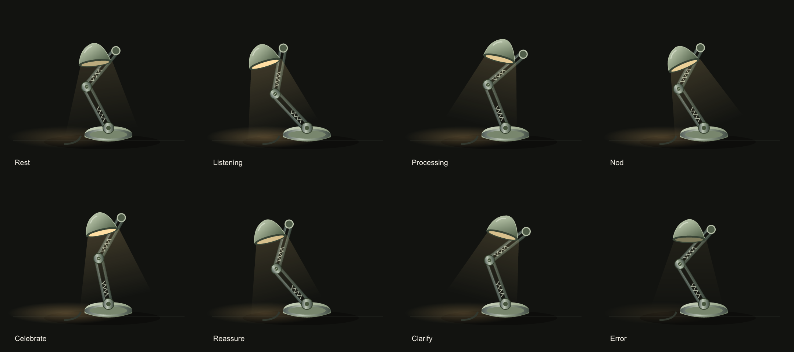

# SentientSignals

**Local speech understanding for emotionally legible robot behavior.**

SentientSignals is a real-time Text + Audio ML prototype that listens to a completed speech
turn, estimates one of seven MELD emotions, and drives a small animated desk-lamp character.
It runs locally: microphone capture, Whisper transcription, MiniLM and wav2vec2 features,
classification, response selection, and animation.

The project is intentionally more than a model notebook. It includes reproducible data
preparation, split-safe experiments, uncertainty handling, a bounded WebSocket service,
cancellable turns, an accessible browser interface, and measured test and latency results.



## Why I built it

An expressive robot needs more than a label. It must perceive a person, respond quickly, and
communicate its state without pretending to know more than it does. This prototype explores
that complete loop with a lightweight lamp character:

```text
microphone / MELD replay
          |
   local Whisper ASR
          |
  +-------+-------+
  |               |
MiniLM         wav2vec2
  |               |
  +-------+-------+
          |
 calibrated probability fusion
          |
 uncertainty + grounded response policy
          |
 text response + interruptible lamp gesture
```

The lamp does not mirror negative emotions theatrically. It acknowledges, reassures, asks for
clarification when confidence is low, and exposes the transcript and probabilities for
inspection.

## Live system

- Push-to-talk microphone input and prepared-WAV replay.
- Local `faster-whisper` `tiny.en` transcription.
- Frozen `all-MiniLM-L6-v2` text and `wav2vec2-base` audio encoders.
- Small PyTorch classification heads with training-only normalization.
- Calibrated 85% text / 15% audio probability fusion.
- Seven MELD emotions: anger, disgust, fear, joy, neutral, sadness, and surprise.
- Confidence and top-two-margin uncertainty rules.
- Deterministic, transcript-aware responses rather than open-ended generation.
- Bounded 16 kHz PCM16 WebSocket transport with stale-turn cancellation.
- Authored SVG lamp gestures with smooth interruption and reduced-motion support.
- Entire deployed path: approximately 155 million learned parameters and 1.21 GB peak RSS.

## Final measured results

The configuration was selected on development dialogues before the official test labels were
opened. The final test set contains 2,610 MELD utterances.

| Model | Macro-F1 | Weighted F1 | Accuracy |
|---|---:|---:|---:|
| **Deployed text/audio fusion** | **0.4032** | **0.5707** | **57.20%** |
| Text only | 0.4023 | 0.5648 | 56.32% |
| Audio only | 0.2228 | 0.3856 | 38.05% |
| Always neutral | 0.0928 | 0.3127 | 48.12% |

The honest conclusion is that text carries nearly all useful predictive signal. The
dialogue-bootstrap 95% confidence interval for fused-minus-text macro-F1 is
`[-0.0088, 0.0096]`, and shuffling audio changes macro-F1 from `0.4032` to `0.4045`.
This experiment does **not** establish a meaningful audio contribution.

The uncertainty policy marks 66.6% of test examples uncertain. On the remaining 33.4%,
accuracy is 78.1%, compared with 46.7% on uncertain examples. The policy therefore provides a
useful behavior signal even though its thresholds are not a substitute for formal calibration.

Full results, per-class metrics, confusion matrices, exclusions, and bootstrap details are in
[`reports/day3_final_evaluation.json`](reports/day3_final_evaluation.json) and
[`reports/day3_final_summary.md`](reports/day3_final_summary.md).

## What I tried

Every experiment used official MELD splits and development-only selection. Failed experiments
were kept because they changed the engineering decision.

| Experiment | Development macro-F1 | Decision |
|---|---:|---|
| Text only, inverse-sqrt class weights | 0.4226 | Strong unimodal baseline |
| Initial 75% text probability fusion | 0.4230 | Tiny gain; refine weight only |
| **Final 85% text probability fusion** | **0.4264** | Deployed; +0.0034 over initial fusion |
| Three-seed ensemble | 0.4341 | Rejected: six heads for a small gain |
| Generic wav2vec2 audio only | 0.2424 | Audio baseline |
| IEMOCAP emotion encoder audio only | 0.2348 | Worse domain/label transfer |
| 32-bin attentive temporal audio pooling | 0.2264 | Worse than mean/std pooling |
| Explicit pitch, energy, rhythm, and pause features | 0.2511 audio | Better audio; fusion unchanged |
| Text-led learned fusion gate | 0.4213 | Worse and more complex |
| Three-turn context concatenated into MiniLM | 0.3096 | Context diluted the target utterance |

A partial wav2vec2 fine-tuning run was also stopped after class collapse: epoch-one macro-F1
was `0.1607`, with no disgust, fear, or sadness predictions. It was not deployed or treated as
a completed comparable benchmark.

These results prevented three common mistakes: assuming an emotion-specific encoder transfers
between datasets, assuming fusion helps because both modalities are present, and adding model
complexity without measured benefit.

## Performance and constraints

Measured locally on Windows 11, Python 3.12, an Intel Core Ultra 5 laptop, and CPU inference:

| Measurement | Result |
|---|---:|
| Warm end-to-end p50 | 1.03 s |
| Warm end-to-end p95 | 1.43 s |
| Cold startup plus first result | 20.62 s |
| Peak process RSS | 1.21 GB |
| Learned parameters | 155,091,975 |
| Whisper WER on the 30-clip feasibility benchmark | 46.9% |

The latency includes WAV reading, local transcription, both encoders, classification, and the
response policy. The high WER is retained as a limitation: short sitcom clips often contain
overlapping voices and surrounding dialogue.

## Engineering decisions

- **Local inference:** predictable privacy and no network dependency after model download.
- **Turn-level processing:** streaming input with inference after button release; not falsely
  described as streaming classification.
- **Split discipline:** official train/dev/test splits; whole development dialogues reserved
  for calibration; test labels opened once after freezing the checkpoint.
- **Shared preprocessing:** the same audio and feature code serves caching and runtime.
- **Resumable caches:** keys include audio content, normalized transcript, preprocessing, and
  pinned encoder revisions.
- **Bounded work:** one active inference job, ten-second input cap, cancellation suppresses
  stale results, and malformed or empty audio receives a safe retry response.
- **Accessible motion:** gesture meaning is also expressed in text; reduced-motion users receive
  static poses.
- **Honest model selection:** the strongest result wins only when the measured improvement
  justifies its runtime cost.

The animated lamp is an original SVG/CSS rig. Its event-driven interruption model was informed
by Human Computer Lab's public LeLamp runtime, but no visual identity, motion trajectory, or
prompt was copied.

## Run the final demo

Python 3.12 is required.

```powershell
py -3.12 -m venv .venv
.\.venv\Scripts\Activate.ps1
python -m pip install -e ".[encoders,asr,serve,dev]"
sentient-serve --checkpoint checkpoints/day3_deployed.pt
```

Open `http://127.0.0.1:8000`, then hold the talk button or replay a prepared mono 16 kHz PCM16
WAV. Encoder and ASR weights must be downloaded once before offline use.

The interview-oriented walkthrough is in [`DEMO_SCRIPT.md`](DEMO_SCRIPT.md).

## Reproduce training and evaluation

Raw MELD media and generated data are intentionally excluded from Git.

```powershell
# Prepare official splits and cache frozen representations
sentient-prepare --output-root data/day2/processed --splits train dev test
python scripts/day2_experiment.py --threads 8

# Refine fusion on development selection data and freeze the artifact
python scripts/day3_accuracy_experiment.py
python scripts/day3_accuracy_experiment.py --apply

# Open the official test labels once
python scripts/day3_evaluate.py
```

Additional experiment entry points:

```powershell
python scripts/audio_encoder_experiment.py --threads 8
python scripts/attentive_audio_experiment.py --threads 8
python scripts/prosody_experiment.py --threads 8
python scripts/gated_fusion_experiment.py --threads 8
python scripts/context_text_experiment.py --threads 8
```

## Validation

```powershell
python -m pytest
python -m ruff check .
npm ci
npm run test:lamp
npm run render:lamp
```

The data audit verified 13,706 prepared clips: 9,988 train, 1,108 development, and 2,610 test.
One corrupt training video and one missing development video are explicitly recorded in
[`reports/data_preparation.json`](reports/data_preparation.json).

## Repository map

```text
src/sentient_signals/  preprocessing, models, inference, policy, service
app/static/            microphone/replay UI and animated SVG lamp
scripts/               experiments, evaluation, and verification
tests/                 unit and integration tests
configs/               reproducible settings
reports/               measured outputs and rendered QA artifacts
```

## Limitations and next steps

- MELD is imbalanced, acted sitcom dialogue; live speech is a domain shift.
- Audio did not demonstrate statistically reliable value in the selected architecture.
- The prototype has no visual perception, speaker diarization, or physical actuator control.
- Conversation context needs per-turn sequence modeling; concatenating turns into one sentence
  embedding failed.
- The next hardware step is to replace the SVG gesture sink with a motor-controller adapter
  while preserving the existing prediction/policy/animation boundary.
